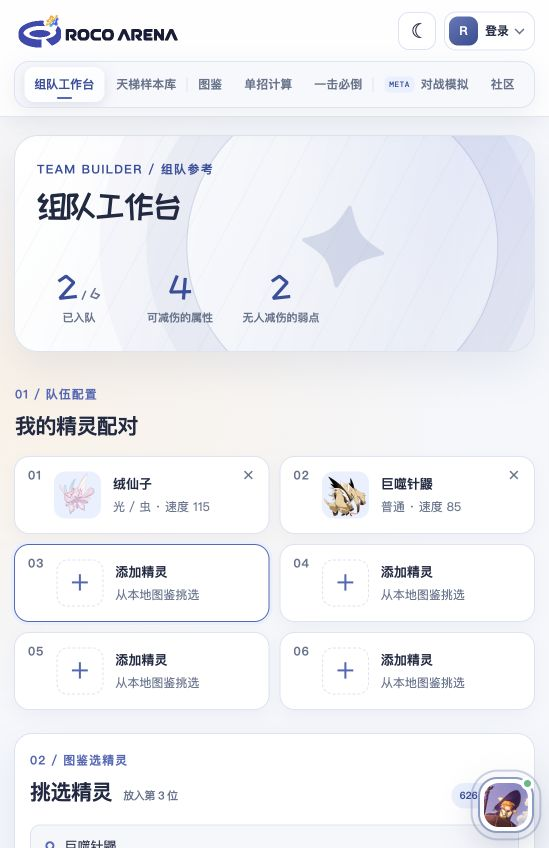
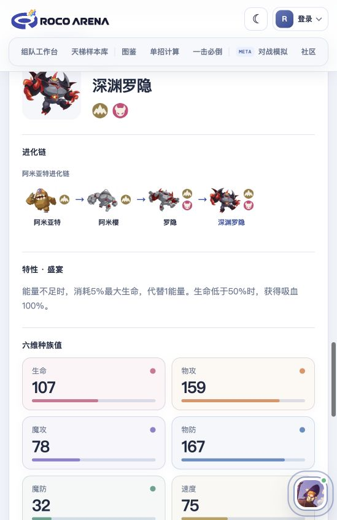

# 🧭 ROCO ARENA · 洛克王国实验室

面向《洛克王国：世界》的图鉴、组队与对战资料工具。把精灵资料、阵容样本和伤害计算放在一起，帮助你查资料、搭阵容、核对实战思路。

**[🌐 访问网站 · rocoarena.com](https://rocoarena.com/)**

## 可以做什么

- **精灵与技能图鉴**：沿进化链查看不同形态，查询属性、六维种族值、特性与技能。
- **六人组队工作台**：搭建队伍，查看全队属性抗性、防守缺口与搭档候选。
- **天梯样本库**：浏览收录阵容，保存个人样本，支持截图识别和游戏阵容码导入、导出。
- **单招计算与一击必倒**：配置精灵、技能和战场条件，计算伤害，查找达到一击线的组合。
- **游戏资料与社区**：连接游戏角色，查看资料，分享阵容与配招思路。

## 📷 网站展示

  
  

## 💬 交流与反馈

遇到问题、发现资料错误，或有新的功能想法，欢迎通过[站内意见反馈](https://rocoarena.com/feedback)或[GitHub Issues](https://github.com/evolraelc/roco-arena-web/issues)告诉我们。

本仓库用于公开项目介绍与说明，源码在独立仓库维护。

本站是非官方玩家工具，游戏内容权利归相应权利人所有。计算与推荐仅供参考，请结合当前游戏版本和实战核对；META 对战模拟仍在开发中。
